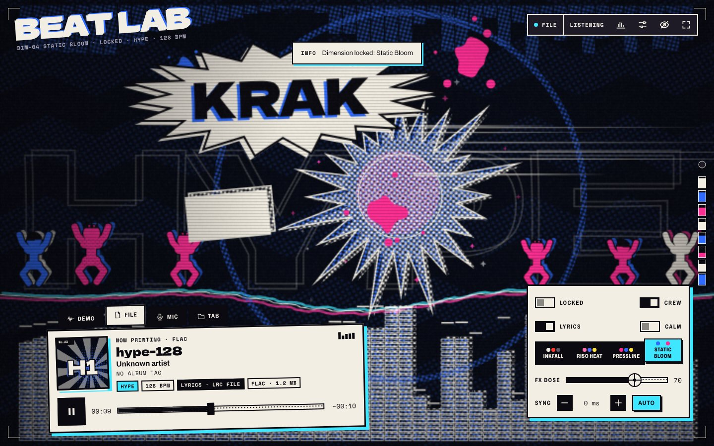
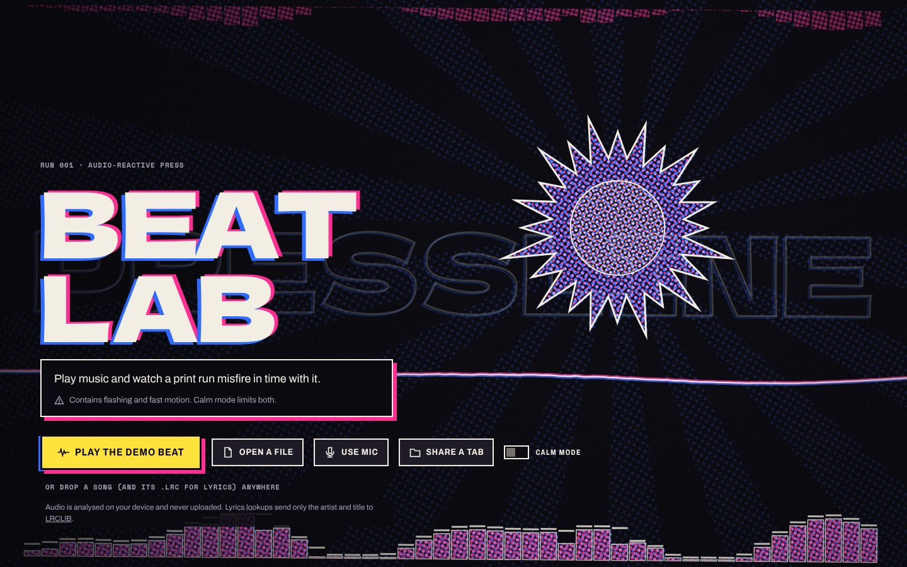
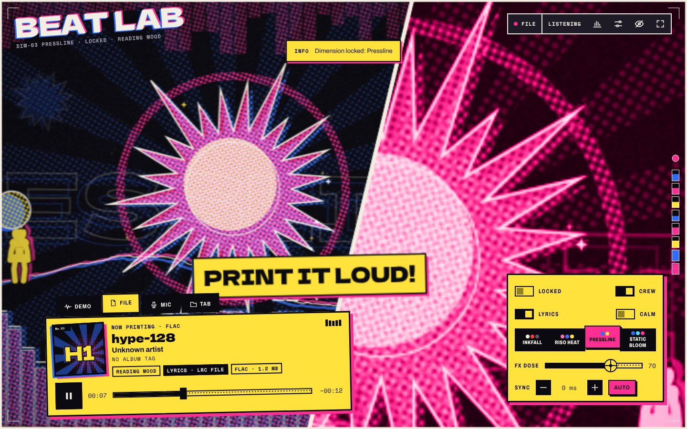
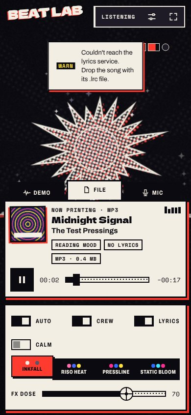
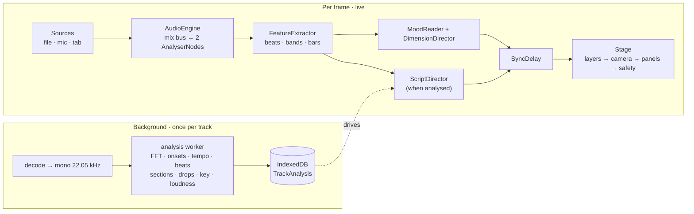

# BEAT LAB

**A browser music player that watches a comic-book print run misfire in time with your songs — and knows each track well enough to see the drop coming.**

BEAT LAB is a fully client-side music player and audio-reactive visualizer. Add your library, and it plays a proper queue while a Canvas 2D "stage" prints the music as halftone comic art: misregistered ink plates, panel cuts on big hits, sound words, synced lyrics and a small crew of ink figures dancing on the beat. It analyses every track once, on your device, so the visuals can **anticipate** — building tension through a riser and hard-cutting on the exact beat of a drop — and it mixes tracks together like a DJ. Nothing you listen to ever leaves the browser.



| Cover                    | Pressline                              | Phone                    |
| ------------------------ | -------------------------------------- | ------------------------ |
|  |  |  |

> New here for an interview or a walkthrough? Read **[docs/CASE-STUDY.md](docs/CASE-STUDY.md)** — it explains the hard problems, the architecture and the decisions behind them.

## What it does

### The player

- **Your library, stored once.** Link a folder (Chrome/Edge) or import files anywhere; tracks and covers persist in **IndexedDB**, imported audio in the **Origin Private File System**. Tags, cover art and ReplayGain are read with `music-metadata`; covers are deduplicated by image hash and thumbnailed. Browse by album, artist, song or playlist, and search (accent-folded, in-memory).
- **A real queue.** Shuffle (Fisher–Yates with history, so Previous walks back what actually played), repeat off/all/one, and a two-deck engine that streams from disk and crossfades between tracks. The queue and position survive a reload.
- **Loudness levelling** to −14 LUFS: ReplayGain tags when present, otherwise a BS.1770 meter measures each track in the background. A limiter guards the ceiling.
- **Feels like an app.** Lock-screen and media-key controls (Media Session), an installable PWA that opens offline (service worker), a responsive shell (desktop sidebar / phone bottom-tabs) with a mini player, and virtualised lists that scroll 10,000 songs at 60 fps.

### The visualizer

- **Three inputs.** Library files, the microphone, or a shared browser tab — all through one Web Audio graph into the analysers, so the picture always matches what you hear.
- **Four "dimensions"** that step up with energy (Inkfall → Riso Heat → Pressline → Static Bloom); each step adds layers rather than turning the same ones up, and changes land on a strong beat.
- **Mood, read on device.** A rule-based quick read lands at ~8 s; then Essentia.js MusiCNN mood classifiers run in a Web Worker and take over. Mood picks the background scene, the dancers' style and how lyrics animate.
- **Synced lyrics** from a dropped `.lrc` or looked up on [LRCLIB](https://lrclib.net).

### See the drop coming

- **Every track is analysed once, in the background** (a throttled queue that pauses when the tab is hidden): beat grid, downbeats, a per-beat energy curve, sections (intro/verse/build/drop/breakdown/outro), **drops**, musical **key**, and loudness — all from one decode, by deterministic in-browser DSP.
- **The stage plays from that script.** With a latency-compensated song clock it holds the ladder through a build, counts the bar in ("WAIT FOR IT… 3… 2… 1"), and **hard-cuts to Static Bloom on the exact beat of the drop** — instead of reacting a frame late.
- **The seek bar is the energy curve**, with section ticks and drop starbursts, plus BPM / key / "Drop at 1:12".

### Share a clip

- One tap records **~15 s of Now Playing as a portrait video with its audio** — a bespoke 9:16 render (second stage), 3-2-1 countdown, a filling ring, then a preview to **Share** (`navigator.share`) or save. **"Clip the drop"** starts 5 s before the drop. A "visuals only" option and a one-line copyright note; recording always uses the strict flash budget.

### Auto-mix

- **Beat-matched transitions.** On shuffle/playlist auto-advance, tempo-compatible analysed tracks hand off like a DJ set: tempo-matched at the nearest octave (`preservesPitch`), started on the outgoing track's downbeat, phase-locked (±0.5 %) for the first bars, with a low-shelf **bass swap** on a downbeat. Mismatched tracks fall back to a clean crossfade.
- **Order by mood and energy.** A seeded beam search sequences the queue along an energy arc (warm-up → peak → cool-down / steady / build), balancing tempo, key, energy and artist spacing.

### Safety & privacy (not optional)

- **Photosensitivity guards** that can't be switched off: full-frame flashes are rationed (3/s, 1/s in strict mode and while recording), and a luminance monitor dims the stage if it flickers too much. Calm mode limits motion and honours `prefers-reduced-motion`.
- **Audio never leaves your device.** The only network request is the optional LRCLIB lyrics lookup (artist + title + duration), switchable off. The mood model and its files are self-hosted.

## How it works



The controller (`src/app.ts`) runs the frame loop: read the analysers → `FeatureExtractor` → mood + the dimension ladder (or, for an analysed file, the `ScriptDirector`) → `SyncDelay` → `Stage`. Separately, a background runner (`src/library/analysis.ts`) decodes each library track once, hands the mono signal to a pure-DSP **analysis worker** (`src/analysis/extract/`), and stores a `TrackAnalysis` in IndexedDB; the stage and the beat-matcher read it back. See **[docs/CASE-STUDY.md](docs/CASE-STUDY.md)** for the deep dive.

## Tech

TypeScript (strict), Vite, Canvas 2D and the Web Audio API. The library/player screens use **Preact + `@preact/signals`**; storage is **`idb`** + OPFS; tags via **`music-metadata`**. The on-device mood model self-hosts **Essentia.js + TensorFlow.js** in a Web Worker. Everything else — beat tracking, section/drop/key detection, loudness, transition planning, ordering — is **own, deterministic TypeScript DSP**, so it's unit-tested against fixed numbers. Unit tests on Vitest; end-to-end + beat-sync regression on Playwright (Chromium).

```
src/
  app.ts               controller: sources, frame loop, clips, actions
  audio/               AudioEngine, two-deck PlaybackEngine (crossfade + beat-match), sources
  analysis/            live features, mood, sync, dimension ladder, script director,
                       transition planner (mix), phase-lock, ordering, metrics
    extract/           offline DSP: fft, spectral (chroma/MFCC), rhythm, structure, key
  library/             IndexedDB, OPFS/files, scan, meta, thumbs, queue, store (signals),
                       loudness (BS.1770), analysis runner, Preact UI
  clip/                clip recorder (studio) + format helpers
  render/              stage, layers, scenes, patterns, safety, band strip
  ai/                  on-device mood model: resampler, mapping, Essentia worker
  lyrics/ meta/ ui/    LRC + LRCLIB, tag/cover parsing, DOM shell
tests/  unit (Vitest) · e2e + beat-sync (Playwright) · harness · fixtures
```

## Run it locally

Requires Node 20.19+.

```bash
npm ci
npm run dev          # http://localhost:5173
npm run check        # typecheck + lint + unit tests
npm run test:e2e     # builds, serves the production build, runs Playwright
```

`npm run dev` also serves the dev-only **Scene Lab** at `/tools/scene-lab/` — preview background scenes, and **annotate** a song (press `D` at drops, `S` at sections) to score the analyser (see [docs/analysis-results.md](docs/analysis-results.md)). It is excluded from `vite build`.

## Deploy & security

The site is fully static (`npm run build` → `dist/`; deploys to Vercel as-is). The **page** Content-Security-Policy stays strict — `script-src 'self'`, no `eval`, no inline scripts, only `lrclib.net` on `connect-src`. Essentia.js needs `eval` (emscripten embind), so **only its Web Worker** is served a scoped `'unsafe-eval'`/`'wasm-unsafe-eval'` policy from `/workers/`; a dedicated worker runs under its own response's CSP, so that permission never reaches the page. `vite preview` serves the same per-path headers so the e2e tests run under production policy. Serve over HTTPS (mic/tab capture require a secure origin).

## Browser support

|                               | Chrome / Edge (desktop) | Firefox   | Safari | Mobile         |
| ----------------------------- | ----------------------- | --------- | ------ | -------------- |
| Import files, play, visualise | yes                     | yes       | yes    | yes            |
| Link a music folder           | yes                     | no        | no     | Android: check |
| Lock-screen / media keys      | yes                     | yes       | yes    | yes            |
| Tab audio                     | yes                     | no        | no     | no             |
| Record / share a clip         | yes (MP4 OS-dependent)  | WebM only | yes    | yes            |

## Roadmap

Phases 1–4 are built: **player core**, **see the drop coming** (analysis + script), **share a clip**, and **auto-mix** (beat-matched transitions + mood/energy ordering). Phase 5 (optional accounts/sync for playlists, settings and analysis — never audio files) is designed in [docs/ROADMAP.md](docs/ROADMAP.md) but not implemented.

## Credits & licence

Artwork is procedural and original; the listening globe is inspired by [thinking-orbs](https://github.com/RareFormLabs/thinking-orbs) (MIT, no code copied). Fonts: Archivo, Dela Gothic One, Space Mono (SIL OFL). Lyrics from [LRCLIB](https://lrclib.net).

Code is **AGPL-3.0-only** (because of Essentia.js); see [LICENSE](LICENSE). The bundled, self-hosted mood model is **Essentia.js** (AGPL-3.0, MTG/UPF), four **MusiCNN-MSD** classifiers (**CC BY-NC-ND 4.0 — non-commercial**, MTG/UPF), and **TensorFlow.js** (Apache-2.0). Because the models are non-commercial, the project as a whole is for non-commercial use. Full terms: [`public/models/ATTRIBUTION.md`](public/models/ATTRIBUTION.md).
