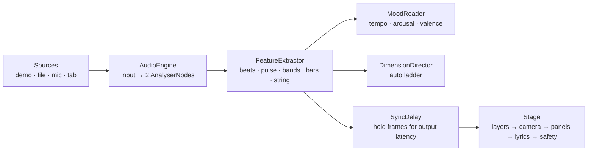

# BEAT LAB

**Play music and watch a comic-book print run misfire in time with it.**

BEAT LAB is an audio-reactive visualizer for the browser. It listens to a song, your microphone or a browser tab, finds the beats, reads the song's mood, and prints the result as halftone comic art: misregistered ink plates, panel cuts on big hits, sound words, synced lyric captions and a small crew of ink figures dancing on the beat.


| Cover                    | Pressline                              | Phone                    |
| ------------------------ | -------------------------------------- | ------------------------ |
|  |  |  |

## Features

- **Four inputs.** A demo beat synthesised live in Web Audio, your own files (MP3, M4A, WAV, OGG, FLAC), the microphone, or a shared browser tab (Chrome and Edge on desktop).
- **Beat detection** tuned for kicks: spectral flux over 20–280 Hz with an adaptive threshold, gated by kick-band share and a 2-frame power rise. Snares and hi-hats drive their own effects.
- **Four "dimensions"** that step up with the song's energy (Inkfall → Riso Heat → Pressline → Static Bloom). Each step adds layers rather than turning the same ones up. Changes land on a strong beat.
- **Mood reading** without a model: tempo, onset density and punch give arousal; spectral tilt gives valence. The mood picks the background, the dancers' style and how lyrics animate.
- **Synced lyrics** from a `.lrc` file you drop with the song, or looked up on [LRCLIB](https://lrclib.net) by artist and title. Words light up on their own timing or on an eighth-note grid.
- **Now-playing card** with title, artist, album and embedded cover art (ID3, MP4 and FLAC tags), or a generated comic cover.
- **Visual sync delay** for Bluetooth headphones: estimated from the output latency the browser reports, adjustable in 20 ms steps.
- **Photosensitivity guards** that can't be switched off: full-frame flashes are rationed to 3 per second (1 in strict mode), and a luminance monitor dims the stage if it flickers too much. Calm mode limits motion and effects.
- **Keyboard-first**: press `?` on the stage for every shortcut. Settings persist across visits.

## How it works



Each animation frame the app reads both analysers, turns them into a `Features` record (`src/analysis/features.ts`), lets the mood reader and the dimension ladder react to the live audio, then passes the frame through the sync delay so the picture can be held back to match what you hear. The `Stage` (`src/render/stage.ts`) draws the layers into an off-screen scene under a "camera" (beat shake, slow roll, pulse zoom), composites it whole or re-cut into comic panels, then adds lyrics, dimension wipes and the safety checks.

**Beats.** Positive spectral flux in the low band must clear `mean × 1.5 + 0.01` of the last 42 frames, the kick band (30–150 Hz) must carry more than −28 dB of total power, and kick power must have risen at least 1.5 dB over two frames. A 230 ms refractory window applies, but a clearly stronger onset replaces a weaker one inside it.

**Dancers.** The ink crew dances on a beat clock: a phase-locked loop that free-runs at the estimated tempo and is pulled toward each detected beat.

**Audio stays on your device.** Nothing is recorded or uploaded. The only network request is the optional lyrics lookup, which sends artist, title and duration to LRCLIB (switch it off in Settings).

## Tech

TypeScript (strict), Vite, Canvas 2D and the Web Audio API. No runtime dependencies besides the self-hosted fonts. Unit tests run on Vitest; end-to-end and beat-sync tests run on Playwright in Chromium.

```
src/
  app.ts               controller: sources, frame loop, actions
  audio/               AudioEngine, demo synth, file / mic / tab sources
  analysis/            features, mood, sync delay, dimension ladder
  lyrics/              LRC parser, LRCLIB client, caption renderer
  meta/                tag parser (ID3, MP4, FLAC), cover art
  render/              stage, layers, patterns, safety, band strip
  ui/                  DOM shell, dialogs
tests/
  unit/                Vitest
  e2e/                 Playwright: UI flows and beat-sync regression
  harness/             offline analysis page used by the beat-sync tests
  fixtures/            synthetic test tracks and tagged files
```

## Run it locally

Requires Node 20.19 or later.

```bash
npm ci
npm run dev          # http://localhost:5173
```

```bash
npm run check        # typecheck + lint + unit tests
npx playwright install chromium
npm run test:e2e     # builds the site, then runs UI and beat-sync tests
```

The beat-sync tests render each fixture track sample-accurately through an `OfflineAudioContext` and score the real analysis code against the known kick grid:

| Track     | Kicks caught | Mean latency | Extra beats | Dancer clock error |
| --------- | ------------ | ------------ | ----------- | ------------------ |
| Hype, 128 | 100%         | 14 ms        | 1           | 16 ms              |
| Grit, 150 | 100%         | 27 ms        | 3           | 26 ms              |
| Dreamy    | no kicks     | —            | 0           | —                  |

## Deploy

The site is fully static. On **Vercel**: import the repository, keep the detected Vite settings, deploy. `vercel.json` adds caching and security headers (a strict Content-Security-Policy that only allows `lrclib.net` for lyrics); `vite preview` serves the same headers so the end-to-end tests run under them.

Any other static host works too: run `npm run build` and publish `dist/`. If the site lives under a sub-path (a GitHub Pages project site, say), build with `npx vite build --base=/beat-lab/`. Serve it over HTTPS, because browsers only allow microphone and tab capture on secure origins.

## Browser support

|                          | Chrome / Edge (desktop) | Firefox | Safari  | Mobile browsers |
| ------------------------ | ----------------------- | ------- | ------- | --------------- |
| Demo beat, files, mic    | yes                     | yes     | yes     | yes             |
| Tab audio                | yes                     | no      | no      | no              |
| Auto sync-delay estimate | yes                     | yes     | partial | varies          |

Where the browser doesn't report output latency, set the sync delay by hand with `,` and `.`.

## Credits

All artwork is procedural and original. Fonts: [Archivo](https://github.com/Omnibus-Type/Archivo), [Dela Gothic One](https://fonts.google.com/specimen/Dela+Gothic+One) and [Space Mono](https://fonts.google.com/specimen/Space+Mono), all under the SIL Open Font License. Synced lyrics courtesy of [LRCLIB](https://lrclib.net).

Code released under the [MIT License](LICENSE).
